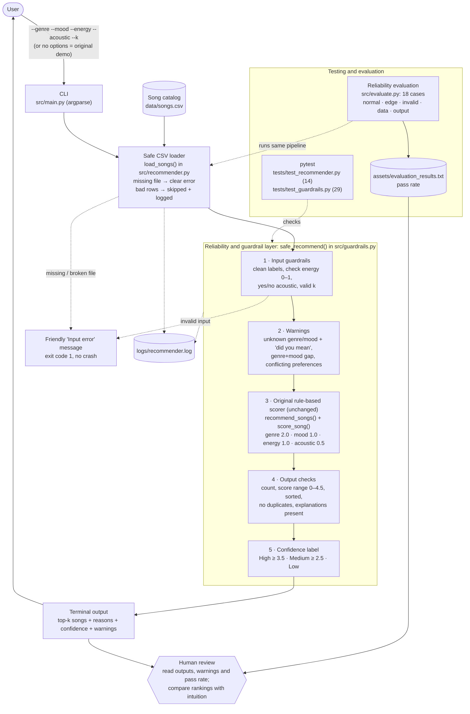

# 🎵 VibeMatch 2.0: A Reliable Rule-Based Music Recommender

## Summary

**VibeMatch 2.0** is a command-line music recommender. You describe your taste (favorite genre, favorite mood, target energy from 0 to 1, and whether you like acoustic music), and it returns the best-matching songs from an 18-song catalog, with the exact points behind every recommendation.

It is a **rule-based recommender**: songs are scored with a fixed, hand-designed formula. It does **not** use a trained machine-learning model or generative AI, and it calls no external APIs or services.

The Week 8 extension adds the advanced feature: an **integrated reliability and guardrail system**. Every recommendation the app makes passes through it:

- **Input guardrails:** profiles are cleaned up (`"  Hip Hop "` → `"hip hop"`), and invalid values (energy `1.7`, acoustic `"maybe"`, `k = 0`) are rejected with a clear message instead of a crash.
- **Warnings:** the app reports unknown genres or moods with a "did you mean" suggestion, genre and mood combinations the catalog doesn't have, and conflicting preferences.
- **Output checks:** results are verified to be the right count, in the valid 0–4.5 range, sorted, free of duplicates, and explained.
- **Confidence label:** each result set is rated **High / Medium / Low** so users know when a recommendation is weak.
- **Logging and safe data loading:** a missing CSV gives a clear error, bad CSV rows are skipped, and everything is logged to `logs/recommender.log`.
- **Measurable evaluation:** `python -m src.evaluate` runs 18 reliability cases and reports a pass rate. 43 `pytest` tests back it up.

---

## The Original Project (Module 3)

This project extends my **Module 3 Music Recommender Simulation** (VibeMatch 1.0). Its goal was to show how a recommender turns data into predictions, and where bias comes from.

VibeMatch 1.0 was a content-based recommender that ran a fixed demo in the terminal. It loaded `data/songs.csv`, scored every song against one hard-coded taste profile, and printed the top 5 with a reason for each point. It also compared four evaluation profiles (including one with conflicting preferences) and ran a weight experiment showing how scoring choices create bias.

**What it couldn't do:**
- Users couldn't enter their own profile.
- Bad input such as `"Pop"`, `"hiphop"` or energy `5` was silently accepted and produced misleading results.
- A missing data file crashed the program.
- There was no way to measure reliability beyond unit tests.

Week 8 fixes these problems **without changing the scoring formula**. For valid inputs, every ranking and score is identical to Module 3 (this is checked automatically).

### How the scoring works (unchanged from Module 3)

Each song is compared with the user profile and gets points from four checks. The maximum is **4.5**.

```
score = genre_points + mood_points + energy_points + acoustic_points

genre_points    = 2.0 if song.genre == user.favorite_genre else 0.0
mood_points     = 1.0 if song.mood  == user.favorite_mood  else 0.0
energy_points   = 1 - abs(song.energy - user.target_energy)            # 0.0 to 1.0
acoustic_points = 0.5 * song.acousticness        if user.likes_acoustic  # 0.0 to 0.5
                  0.5 * (1 - song.acousticness)  otherwise
```

1. **Genre match (+2.0):** the strongest signal, because genre describes the overall sound (instruments, style, production).
2. **Mood match (+1.0):** a softer label that shows up across many genres, so it's worth half as much.
3. **Energy similarity (0 to +1.0):** rewards closeness to the target, not loudness. If the target is 0.80, a 0.82 song earns 0.98 and a 0.35 song earns 0.55.
4. **Acoustic fit (0 to +0.5):** separates acoustic songs (jazz, lofi, classical) from produced ones (EDM, pop). Its weight is low so it fine-tunes the order without taking over.

**Ranking:** every song is scored and sorted from highest to lowest score. Ties go to the higher energy points, then the lower song `id`, so the same input always gives the same list. The top `k` songs (default 5) are returned with their explanations.

**Why content-based?** Real platforms like Spotify combine *collaborative filtering* ("users like you also liked…") with *content-based filtering* ("this song is similar to what you like"). This project has no data about other users, so it uses content-based filtering. That only needs song attributes and one user's stated preferences, and it makes every recommendation easy to explain.

**Song features:** `id`, `title`, `artist`, `genre`, `mood`, `energy` (0–1), `tempo_bpm`, `valence`, `danceability`, `acousticness` (0–1).
- **Scored:** `genre`, `mood`, `energy`, `acousticness`.
- **Not scored:** `tempo_bpm` overlaps with energy, `valence` overlaps with mood, and `danceability` has no matching profile field.

### Module 3 evaluation results

Top-5 results with the original weights (from `python -m src.main`):

| Profile | #1 | #2 | #3 | #4 | #5 |
|---|---|---|---|---|---|
| High-Energy Pop (pop, happy, 0.9, non-acoustic) | Sunrise City 4.330 | Gym Hero 3.445 | Rooftop Lights 2.185 | Bassline Theory 1.475 | Storm Runner 1.440 |
| Chill Lofi (lofi, relaxed, 0.2, acoustic) | Library Rain 3.280 | Focus Flow 3.190 | Midnight Coding 3.135 | Coffee Shop Stories 2.275 | Slow Burn Sunday 2.025 |
| Deep Intense Rock (rock, angry, 0.95, non-acoustic) | Storm Runner 3.410 | Slow Burn Sunday 2.725 | Iron Horizon 2.460 | Gym Hero 1.455 | Bassline Theory 1.425 |
| Conflicting: Peaceful Metal (metal, peaceful, 0.1, acoustic) | Quiet Sonata No. 3 2.405 | Iron Horizon 2.150 | Spacewalk Thoughts 1.280 | Library Rain 1.180 | Coffee Shop Stories 1.175 |

- **Energy and acoustic fit separate listening situations well.** The Pop and Lofi lists share no songs.
- **Genre labels can override the actual sound.** For Deep Intense Rock, the calm rock song *Slow Burn Sunday* (energy 0.45) ranks #2, above the angry, high-energy metal song *Iron Horizon*.
- **Conflicting preferences produce a mixed list.** The Peaceful Metal user gets a classical piece first and the aggressive metal song second.

**Weight experiment (Deep Intense Rock), genre 2.0 → 1.0 and energy 1.0 → 2.0:**

| Rank | Original | Experiment |
|---|---|---|
| 1 | Storm Runner (3.410) | Iron Horizon (3.440) |
| 2 | Slow Burn Sunday (2.725) | Storm Runner (3.370) |
| 3 | Iron Horizon (2.460) | Gym Hero (2.435) |
| 4 | Gym Hero (1.455) | Bassline Theory (2.365) |
| 5 | Bassline Theory (1.425) | Slow Burn Sunday (2.225) |

The experiment helped this profile, but it made genre matter much less everywhere. For example, the only metal song dropped out of the Peaceful Metal top 5. The original weights remain the default. Full analysis is in the [Model Card](model_card.md#7-evaluation).

---

## Architecture Overview

The Mermaid source is in [diagrams/architecture.mmd](diagrams/architecture.mmd). A copy is below so it renders on GitHub.



**Data flow:**
1. The user's options are parsed in `src/main.py`.
2. The catalog is loaded safely by `load_songs()`.
3. `safe_recommend()` in `src/guardrails.py` cleans and checks the profile.
4. It calls the **unchanged** `recommend_songs()` scorer.
5. It checks the output and assigns a confidence label.
6. The terminal shows the songs, reasons, confidence and warnings.

Problems end in a friendly error message, and everything is logged.

**Where testing and human review happen:**
- `pytest` checks the scorer and the guardrails.
- `src/evaluate.py` runs the same pipeline the app uses and saves a pass rate.
- A person reviews the outputs, warnings and evaluation report and compares rankings with intuition. This is how the Module 3 biases were found.

### Project structure

```
src/
  recommender.py   # original scoring + ranking (unchanged), safe CSV loading, logging
  guardrails.py    # NEW: input validation, warnings, output checks, confidence, safe_recommend()
  main.py          # CLI (argparse); no options = original Module 3 demo
  evaluate.py      # NEW: reliability evaluation, saves assets/evaluation_results.txt
tests/
  test_recommender.py  # 14 original tests (unchanged)
  test_guardrails.py   # NEW: 29 guardrail, data-loading and CLI tests
data/songs.csv         # 18-song catalog
diagrams/architecture.mmd
assets/evaluation_results.txt
logs/recommender.log   # created when the app runs (git-ignored)
```

---

## Setup (Windows)

Requires Python 3. Tested with Python 3.13.7 on Windows 11.

```powershell
# 1. (Optional) create and activate a virtual environment
python -m venv .venv
.venv\Scripts\activate          # Mac/Linux: source .venv/bin/activate

# 2. Install the only dependency (pytest, for tests)
pip install -r requirements.txt

# 3. Run the original demo
python -m src.main
```

Run all commands from the project folder.

### Commands

```powershell
python -m src.main                                                          # original Module 3 demo (now with confidence + warnings)
python -m src.main --genre pop --mood happy --energy 0.8 --acoustic no --k 3   # your own profile
python -m src.main --help                                                   # list all options
python -m pytest -v                                                         # run all 43 tests
python -m src.evaluate                                                      # reliability evaluation + pass rate
```

**Options:**
- `--genre` (required)
- `--mood` (required)
- `--energy` (required, 0.0–1.0)
- `--acoustic yes|no` (default `no`)
- `--k` (number of results, default 5)
- `--data` (CSV path, default `data/songs.csv`)

Valid runs exit with code 0. Rejected input or data exits with code 1 and a clear message.

---

## Sample Interactions

All outputs below are copied from actual runs.

### 1. Messy input is cleaned (normal case, high confidence)

```
> python -m src.main --genre "  Hip Hop " --mood CONFIDENT --energy 0.7 --k 2
Loaded 18 songs from data/songs.csv

User profile: genre=hip hop, mood=confident, energy=0.7, likes_acoustic=False
Confidence: High (top song scored 4.42/4.5: strong match on genre, mood and energy)

Top 2 recommendations:

1. Concrete Verses by Dre Malone
   Genre: hip hop | Mood: confident
   Score: 4.420 / 4.5
   Reasons:
     - genre match (hip hop): +2.0
     - mood match (confident): +1.0
     - energy similarity (0.72 vs. target 0.70): +0.980
     - acoustic fit (acousticness 0.12, prefers non-acoustic): +0.440

2. Night Drive Loop by Neon Echo
   Genre: synthwave | Mood: moody
   Score: 1.340 / 4.5
   Reasons:
     - genre mismatch (synthwave vs. hip hop): +0.0
     - mood mismatch (moody vs. confident): +0.0
     - energy similarity (0.75 vs. target 0.70): +0.950
     - acoustic fit (acousticness 0.22, prefers non-acoustic): +0.390
```

For comparison, a typo (`--genre hiphop`) is not silently accepted. Concrete Verses is still #1, but it loses its genre points, so the app warns the user and lowers the confidence:

```
User profile: genre=hiphop, mood=confident, energy=0.7, likes_acoustic=False
Confidence: Low (top song scored 2.42/4.5: no song closely matches this profile)
Warning: The genre 'hiphop' is not in the catalog, so no song can earn genre points. Did you mean 'hip hop'?
```

### 2. Conflicting preferences are flagged (edge case, low confidence)

```
> python -m src.main --genre metal --mood peaceful --energy 0.1 --acoustic yes --k 3
Loaded 18 songs from data/songs.csv

User profile: genre=metal, mood=peaceful, energy=0.1, likes_acoustic=True
Confidence: Low (top song scored 2.40/4.5: no song closely matches this profile)
Warning: No song in the catalog is both 'metal' and 'peaceful', so the top results can match your genre or your mood, but not both.
Warning: Conflicting preferences: 'metal' songs here average energy 0.97, but your target is 0.10. Expect a mix of metal songs and songs from other genres that match your energy.
Warning: Conflicting preferences: you prefer acoustic music, but 'metal' songs here are not acoustic (average acousticness 0.04).

Top 3 recommendations:

1. Quiet Sonata No. 3 by Elise Moreau Trio
   Genre: classical | Mood: peaceful
   Score: 2.405 / 4.5
   Reasons:
     - genre mismatch (classical vs. metal): +0.0
     - mood match (peaceful): +1.0
     - energy similarity (0.18 vs. target 0.10): +0.920
     - acoustic fit (acousticness 0.97, prefers acoustic): +0.485

2. Iron Horizon by Grave Signal
   Genre: metal | Mood: angry
   Score: 2.150 / 4.5
   Reasons:
     - genre match (metal): +2.0
     - mood mismatch (angry vs. peaceful): +0.0
     - energy similarity (0.97 vs. target 0.10): +0.130
     - acoustic fit (acousticness 0.04, prefers acoustic): +0.020

3. Spacewalk Thoughts by Orbit Bloom
   Genre: ambient | Mood: chill
   Score: 1.280 / 4.5
   Reasons:
     - genre mismatch (ambient vs. metal): +0.0
     - mood mismatch (chill vs. peaceful): +0.0
     - energy similarity (0.28 vs. target 0.10): +0.820
     - acoustic fit (acousticness 0.92, prefers acoustic): +0.460
```

The ranking is the same as in Module 3. What changed is that the user is now told *why* the list looks mixed.

### 3. Invalid input and a missing file are handled without crashing

```
> python -m src.main --genre pop --mood happy --energy 1.7
Loaded 18 songs from data/songs.csv
Input error: Energy must be between 0.0 and 1.0 (got 1.7).

> python -m src.main --genre pop --mood happy --energy loud
Loaded 18 songs from data/songs.csv
Input error: Energy must be a number between 0.0 and 1.0 (got 'loud').

> python -m src.main --genre pop --mood happy --energy 0.8 --acoustic maybe
Loaded 18 songs from data/songs.csv
Input error: Acoustic preference must be yes or no (got 'maybe').

> python -m src.main --genre pop --energy 0.8
Loaded 18 songs from data/songs.csv
Input error: Please provide --mood (or run with no options to see the demo).

> python -m src.main --genre pop --mood happy --energy 0.8 --data data/missing.csv
[log] ERROR: Song file not found: data/missing.csv
Data error: Song file not found: 'data/missing.csv'. Check the path and try again.
```

Each of these exits with code 1 and no Python traceback.

### Original demo (no options)

`python -m src.main` still runs the full Module 3 demo: the default pop profile, the four evaluation profiles and the weight experiment. Every song and score is identical to Module 3. The only additions are a confidence label and any warnings. For example:

```
--- Chill Lofi: genre=lofi, mood=relaxed, energy=0.2, likes_acoustic=True ---
  1. Library Rain (lofi, chill)                 3.280
  ...
  Confidence: Medium
  Warning: No song in the catalog is both 'lofi' and 'relaxed', so the top results can match your genre or your mood, but not both.
```

---

## Design Decisions

- **Reliability and guardrails as the advanced feature (not RAG or an agent).** The recommender is a transparent scoring formula with a tiny local catalog. There are no documents to retrieve and no multi-step task to plan. Its real weaknesses were silent bad input, crashes on bad data and overconfident-looking results. Guardrails address exactly those, and they need no API, model or new dependency.
- **Guardrails wrap the scorer instead of changing it.** `safe_recommend()` validates the input, calls the original `recommend_songs()`, then checks the output. This keeps the Module 3 behavior (and its 14 tests) intact, and evaluation case 4 checks that the guarded and original rankings are identical.
- **Reject vs. warn.** Values that can't be scored safely (energy outside 0–1, non-numbers, a missing field, a bad `k`) are **rejected**. Values that can be scored but may mislead (unknown genre, genre/mood gap, conflicting preferences, `k` larger than the catalog) produce **warnings** and still return results. That way the user stays in control.
- **Simple confidence thresholds.** High (≥ 3.5) usually means a genre + mood + energy match. Medium (≥ 2.5) usually means a genre match only. Low means no genre match. They are hand-picked from the scoring formula, not learned, and are easy to explain.
- **Conflict detection uses catalog averages.** If the requested genre's songs average far from the target energy (gap ≥ 0.5), or clash with the acoustic preference, the app says so.
- **Standard library only.** `argparse`, `logging`, `csv` and `difflib` (for "did you mean") are built into Python. `pandas` and `streamlit` were removed from `requirements.txt` because no code used them, so `pytest` is the only dependency.
- **Logs go to a file.** The terminal shows only the recommendations and real problems. `logs/recommender.log` keeps every request, warning, skipped row and error, and it is git-ignored.

---

## Testing and Reliability Results

### Automated tests: 43 passed

```
> python -m pytest -q
...........................................                              [100%]
43 passed in 0.23s
```

- `tests/test_recommender.py` (14 tests, unchanged from Module 3): loading, each scoring component, ranking, tie-breaking and weights.
- `tests/test_guardrails.py` (29 tests, new):
  - the guarded rankings match the original scorer
  - confidence labels
  - input cleaning
  - unknown-label suggestions
  - conflict and genre/mood-gap warnings
  - `k` capping
  - 7 invalid profile values, 3 invalid `k` values, a missing field and an empty catalog
  - a missing CSV, bad CSV rows and missing CSV columns
  - output checks
  - CLI success and graceful CLI failures

### Reliability evaluation: 18/18 cases passed (100%)

`python -m src.evaluate` runs 18 cases through the same pipeline the app uses and saves the report to [assets/evaluation_results.txt](assets/evaluation_results.txt):

```
#  Result Type     Case                                              Details
------------------------------------------------------------------------------------------------------------------------
1  PASS   Normal   Default pop profile ranks Sunrise City #1         #1 Sunrise City, confidence High, 0 warnings
2  PASS   Normal   Deep Intense Rock ranks Storm Runner #1           #1 Storm Runner, confidence Medium
3  PASS   Normal   Chill Lofi: top 3 lofi + genre/mood gap warning   top 3 all lofi: True, genre/mood gap warned: True
4  PASS   Normal   Guardrails do not change original scoring         5 profiles: guarded results identical to original recommend_songs()
5  PASS   Normal   Same input gives same output (reproducible)       3 runs gave the same ranking
6  PASS   Edge     Messy input ('  Hip Hop ', 'CONFIDENT') cleaned   cleaned to genre='hip hop', #1 Concrete Verses
7  PASS   Edge     Unknown genre 'hiphop' warns + suggests           suggestion given: True, still 5 results
8  PASS   Edge     Conflicting prefs (Peaceful Metal) flagged        2 conflict warnings, confidence Low
9  PASS   Edge     k larger than catalog is capped                   k=50 capped to 18 with warning
10 PASS   Invalid  Energy 1.5 is rejected                            rejected: Energy must be between 0.0 and 1.0 (got 1.5).
11 PASS   Invalid  Energy 'loud' is rejected                         rejected: Energy must be a number between 0.0 and 1.0 (got 'loud').
12 PASS   Invalid  Acoustic 'maybe' is rejected                      rejected: Acoustic preference must be yes or no (got 'maybe').
13 PASS   Invalid  k = 0 is rejected                                 rejected: Number of recommendations must be at least 1 (got 0).
14 PASS   Invalid  Missing 'mood' field is rejected                  rejected: The user profile is missing: mood.
15 PASS   Invalid  Blank genre is rejected                           rejected: 'genre' must be a non-empty word, for example 'pop'.
16 PASS   Data     Missing CSV file gives a clear error              rejected: Song file not found: 'data/does_not_exist.csv'. Check the path and try again.
17 PASS   Data     Malformed CSV rows are skipped, not fatal         loaded 1 of 4 rows (3 bad rows skipped)
18 PASS   Output   Output check catches bad results                  detected 4 problems (range, order, duplicate, missing explanation)
------------------------------------------------------------------------------------------------------------------------
Pass rate: 18/18 cases passed (100%)
```

**What the 100% does and doesn't mean.** The cases were written together with the guardrails, so a perfect pass rate shows the system *behaves as designed* and is reproducible. It does **not** show that the recommendations are *good* for real listeners. The Module 3 biases are still there, for example exact genre matching (*Rooftop Lights*, "indie pop", gets no credit from a "pop" fan), and no guardrail catches them. The confidence labels and warnings make the weaker results visible, but they don't fix them. A crash in any case is counted as a failure rather than stopping the run, so the evaluation can actually fail.

---

## Limitations and Risks

- **Exact genre and mood matching:** `"indie pop"` gets no credit from a `"pop"` user, and `"chill"`, `"relaxed"` and `"peaceful"` count as completely different moods.
- **Genre dominates:** +2.0 for genre beats the best possible energy and acoustic bonus (+1.5), so a song's label can matter more than how it sounds.
- **Tiny, uneven catalog:** 18 songs, and 11 of the 14 genres have only one song.
- **Guardrails are rule-based too.** Confidence thresholds and conflict rules are hand-picked. The "did you mean" suggestion only catches spelling-like mistakes, not meaning (it can't map "chill" to "relaxed").
- **No learning:** the system ignores skips, replays and other users. The same profile always gets the same list, which risks a filter bubble.

See the [Model Card](model_card.md) for limitations, bias, misuse and evaluation details.

---

## Reflection

**Module 3: how recommenders turn data into predictions.** VibeMatch never "hears" a song. It only compares labels (genre, mood) and numbers (energy, acousticness) with what the user said they want, then adds up weighted points. In the Phase 4 experiment, halving the genre weight and doubling the energy weight moved *Iron Horizon* from #3 to #1 for the same user and the same songs. Bias came from the data and the rules, not from intent: exact genre matching, a heavy genre weight and an uneven catalog all shaped who got good recommendations.

My biggest takeaway from this project is that recommendation systems depend heavily on the data and scoring rules used to make predictions. I was surprised that changing a few weights could completely change the recommended songs. This helped me understand that even simple algorithms can influence what people see and listen to.

**Week 8: making it reliable.** Adding guardrails showed how much the original version hid from the user:
- A typo like `hiphop` used to quietly drop the top score from 4.42 to 2.42 with no explanation.
- Two of the four Module 3 evaluation profiles asked for genre/mood combinations that don't exist in the catalog.

The scoring didn't need to change. The system needed to be honest about its inputs and its confidence.

I learned that making a system reliable is just as important as making it work. Adding guardrails and testing helped me understand how to handle invalid inputs, detect problems, and make the recommendations more trustworthy. I also learned that passing tests does not always mean the recommendations will be perfect for every user.

**What this project says about me as an AI engineer.** This project shows that I care about building systems that are reliable, explainable and honest about their limits. I kept the design simple, reused my existing code instead of rebuilding it, and only reported results that came from actually running the program. I describe the system for what it really is, a rule-based recommender, and I document its biases instead of hiding them.
